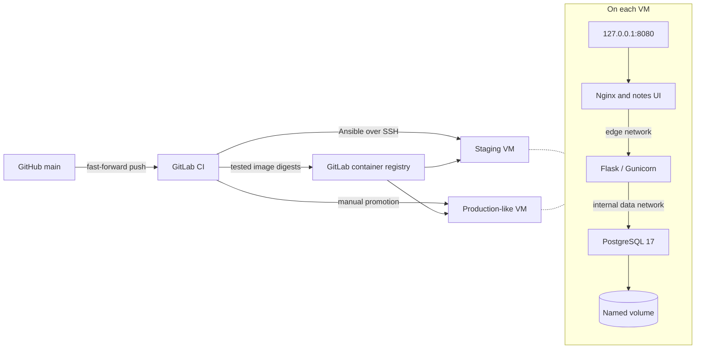

# DeployDock

DeployDock provisions a clean Ubuntu VM, deploys a multi-service application, and verifies the release through the same HTTP interface a user sees. If activation fails, the host restores and checks the last verified release. A PostgreSQL volume keeps notes across deployments.



| Component | Responsibility |
| --- | --- |
| Ubuntu 24.04 LTS amd64 | VM target with systemd, OpenSSH and Docker Engine |
| Docker and Compose | Versioned images, isolated networks, health checks and persistent storage |
| Bash | Host validation, deployment journal, smoke checks and recovery |
| Ansible | Idempotent host setup and release delivery over SSH |
| GitHub and GitLab CI | Canonical source, image builds and registry, staging verification and manual promotion |
| Nginx, Python and PostgreSQL | A RawBlock notes UI and a real HTTP-to-database workflow |

## Run locally

Use a Linux shell with Docker Engine, Compose, Bash, OpenSSL, curl and jq. The commands below use port 8080. Set `APP_PORT` before starting Compose to use a different loopback port.

```bash
install -d -m 0700 secrets
if [[ ! -s secrets/db_password ]]; then
  (umask 077; openssl rand -hex 32 > secrets/db_password)
fi
chmod 0444 secrets/db_password
docker compose -f compose.yaml -f compose.dev.yaml up -d --build --wait
scripts/smoke "http://127.0.0.1:${APP_PORT:-8080}" dev
```

Open [DeployDock on localhost](http://127.0.0.1:8080) and save a note. `docker compose down` stops the stack and keeps the volume. Edit `app/backend` or `app/frontend` and rerun the build command to test changes. Copy `.env.example` to `.env` if you want persistent local settings.

## Provision and deploy

Use a fresh Ubuntu 24.04 amd64 VM with Python 3, OpenSSH and a sudo-capable bootstrap account. The Ansible controller needs Python 3.12+ and access to the VM over SSH. Verify the VM host key through its console before connecting. Add your hosts and public keys to an inventory as shown in the [VM setup guide](docs/vm.md).

```bash
python3 -m venv .venv
source .venv/bin/activate
pip install -r ci/controller-requirements.txt
cd infra/ansible
ansible-galaxy collection install -r requirements.yml
ansible-playbook -i ../../.deploydock/inventory.yml playbooks/provision.yml --limit stage
ansible-playbook -i ../../.deploydock/inventory.yml playbooks/deploy.yml --limit stage \
  -e @../../.deploydock/release.json
```

The release JSON contains a release ID and both application image digests. See [publishing and deployment](docs/vm.md#publish-and-deploy) for the exact commands to produce it, authenticate to a registry and run the deploy playbook as the restricted SSH account. For automatic delivery, follow the [GitHub and GitLab setup](docs/ci.md).

On the VM, use a trusted sudo-capable SSH account:

```bash
sudo deploydock check-host
sudo deploydock status
sudo deploydock verify
sudo deploydock logs
sudo deploydock rollback
sudo deploydock recover
```

Run `rollback` to activate the previous verified release. Run `recover` if a transaction was interrupted or reported failed recovery. Read the [operations guide](docs/operations.md) for exit codes, diagnostics, backup and migration policy.

## Verify

```bash
python3 -m venv .venv
source .venv/bin/activate
pip install -r ci/lint-requirements.txt
pip install --require-hashes --only-binary=:all: -r app/backend/requirements.txt
ci/validate
PYTHONPATH=app/backend python -m unittest discover -s tests/unit
bash tests/unit/test_release.sh
docker compose -f compose.yaml -f compose.dev.yaml build
tests/integration/release.sh
```

The integration test uses a temporary loopback registry, a unique Compose project and a disposable database volume. It exercises a first-deployment failure, rollback after readiness and functional smoke failures, an interrupted transaction, manual rollback, dependency failure and data persistence. See [verification results](docs/verification.md) for executed checks and infrastructure limits.

DeployDock runs one Compose stack per VM. It binds HTTP to loopback and has no end-user authentication. Use an SSH tunnel with a trusted operator account, or place an authenticated TLS proxy on the host for shared access. Expect brief service interruption during deployment and recovery. GitLab staging and production-like deployments should use separate hosts, keys and registry credentials.
